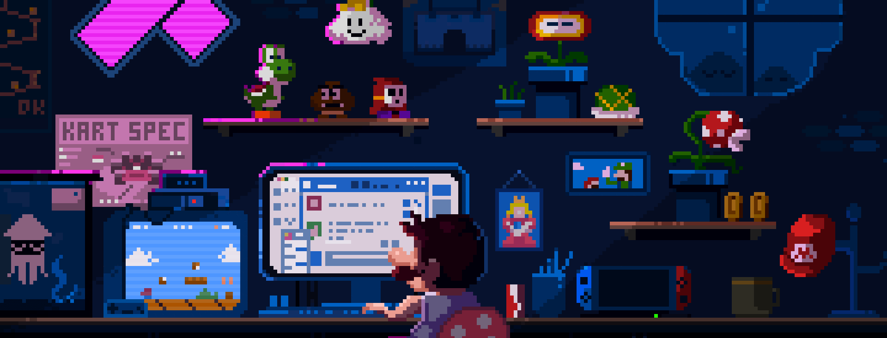

  

<h1 align="center">Hi 👋, I'm Deepanshu Khatri</h1>
<h3 align="center">A full stack developer and tech enthusiast from New Delhi.</h3>

  
  
  

- 🌱 Exploring **AI and full stack development**
- 🧠 Building **trustworthy interfaces**
- 🛠️ Using **TypeScript, React, Python, Go, and Rust**
- 📍 Based in **New Delhi, India**
- ⚡ Turning ideas into **useful products**

 

<h2>🧰 Languages and Tools</h2>

  

<h1>🔥 My Stats 🔥</h1>
 

  

  Built with curiosity · Improved with every commit

