  

<h1 align="center">Hi 👋, I'm Deepanshu Khatri</h1>
<h3 align="center">A full stack developer and tech enthusiast from New Delhi.</h3>

  
  
  

- 🌱 I’m currently exploring **AI products, full stack systems, and developer tooling**
- 🧠 I enjoy building **trustworthy interfaces and reliable workflows**
- 🛠️ My toolkit includes **TypeScript, JavaScript, React, Next.js, Node.js, Python, Go, and Rust**
- 📍 Based in **New Delhi, India**
- ⚡ Fun fact: **I like turning ambitious ideas into useful products**

 

<h2>🚀 Featured Projects</h2>

  
  
  

<h2>🧰 Languages and Tools</h2>

  

<h2>🔥 My GitHub Stats</h2>

  
    
  
    
  

<h2>🤝 Let’s connect</h2>

  I’m always interested in thoughtful products, interesting technical challenges, and conversations about building for the web. Visit my <a href="https://github.com/Deepanshu-2006">GitHub profile</a> to explore more.

  Built with curiosity · Improved with every commit

